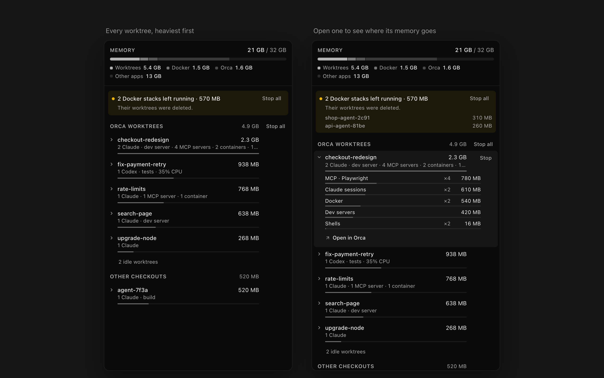

<div align="center">


<h1>Worktree Load</h1>

<p><b>What each worktree costs your Mac, and a Stop button for each one.</b></p>

<p>
<a href="https://github.com/gaspardmoindrot/orca-worktree-load/actions/workflows/ci.yml"></a>


<a href="LICENSE"></a>
</p>

<p>
<a href="#install">Install</a> ·
<a href="#what-it-shows">What it shows</a> ·
<a href="#how-a-process-gets-its-worktree">How it counts</a> ·
<a href="#what-stop-does">What Stop does</a> ·
<a href="#privacy-and-access">Privacy and access</a> ·
<a href="#settings">Settings</a> ·
<a href="#requirements-and-limits">Limits</a>
</p>

<picture>
  <source media="(prefers-color-scheme: light)" srcset="assets/screenshot-light.png">
  
</picture>

<sub>Drawn by the real panel with invented sample data.</sub>

</div>

Worktree Load is a plugin for [Orca](https://github.com/stablyai/orca). Run a few agents in parallel worktrees and your Mac fills up: each Claude session, its MCP servers, the dev server it started, the Docker stack of its branch. Activity Monitor shows a hundred `node` processes. This shows them per worktree, in Orca's right sidebar, and stops a worktree's load in one click.

> [!NOTE]
> macOS only. It reads processes with `ps`, `lsof`, `top` and `sysctl`.

## Install

In Orca: **Settings → Plugins**, find **Worktree Load** in the community catalog, install it and approve its access.

Or from a terminal:

```sh
orca plugin install gaspardmoindrot/orca-worktree-load
```

Then open it from the gauge icon in the right sidebar, or click its item in the status bar.

## What it shows

- **The Mac's memory** at the top, split between worktrees, Docker, Orca and other apps.
- **One row per worktree** with its memory and what runs there: `2 Claude · dev server · 4 MCP servers · 2 containers`. Its CPU shows only when it is busy (3% of the Mac or more). Rows are sorted heaviest first, Orca's worktrees apart from other git checkouts.
- **Open a row** to see where the memory goes: MCP servers by name (`MCP · Playwright ×4`), Claude or Codex sessions, dev servers, tests, builds, shells, Docker. **Open in Orca** jumps to the worktree.
- **Docker stacks left running** by worktrees you already deleted, with their memory.
- **Status bar**: `5.4 GB in 5 worktrees`, orange or red with macOS memory pressure. Click it to open the panel.
- **One notification per episode of memory pressure**, naming the heaviest worktree.

Worktrees that only have open terminals are folded into "N idle worktrees".

## How a process gets its worktree

Every 5 seconds the plugin reads every process with `ps`, and the working directory of each new one with `lsof`. A process belongs to:

1. the worktree that holds its working directory: an Orca worktree, or any other git checkout (worktrees made by Claude Code, by hand, by other tools);
2. Docker, if it is Docker Desktop or its VM;
3. otherwise its parent's worktree: an MCP server started by Claude counts for Claude's worktree, even if it runs from `/`.

Memory is the footprint Activity Monitor shows. CPU is averaged over the last 30 seconds.

Docker's VM is one process for macOS. Every 30 seconds the plugin reads `docker ps` and `docker stats` and counts each container under the worktree of its compose folder (`com.docker.compose.project.working_dir`). The VM's own overhead stays in the Docker part of the bar, so nothing is counted twice.

## What Stop does

Nothing happens until you click a **Stop** button.

- **A worktree**: SIGTERM to its agents, MCP servers, dev servers, tests and builds, then SIGKILL 3 seconds later for what is left, and `docker stop` on its containers. Its shells are left alone, so its terminal tabs stay open, back at their prompt.
- **Never stopped**: shells, anything inside an app bundle (Orca, your editor, your terminal app), tools shared between worktrees (tmux, screen, ssh-agent, gpg-agent, watchman, Gradle, Turbo and Nx daemons), and the plugin itself. Each PID is checked again right before the signal, so a PID reused since the last sample is never hit.
- **A Docker stack whose worktree was deleted**: `docker compose down`, only if every container of that compose project lives in a folder that no longer exists. Otherwise only its own containers get `docker stop`.
- **Stop all** does the same for every row of a section.

## Privacy and access

Nothing leaves your Mac: no network calls, no telemetry. Nothing is written to disk.

| Orca access | Why |
|---|---|
| `workspace:read` | Know which folders are Orca worktrees, with their names and branches |
| `workspace:write` | **Open in Orca** |
| `notifications:show` | The memory pressure notification |
| `settings:own` | The settings below |

Like every plugin with a worker, it runs as you on your Mac. The commands it runs: `ps`, `lsof`, `top`, `sysctl`, `docker ps` and `docker stats`; only when you click Stop, signals and `docker stop` or `docker compose down`; and `orca plugin open` when you click the status bar item.

## Settings

In Orca: **Settings → Plugins → Worktree Load**.

| Setting | Default | What it does |
|---|---|---|
| Sample every (seconds) | 5 | How often every process is read |
| Read Docker every (seconds) | 30 | `docker stats` takes about a second and a half; 0 turns Docker off |
| Count git checkouts Orca does not manage | on | Worktrees made by Claude Code, other tools or by hand, found by their `.git` |
| Notify on memory pressure | on | One notification per episode |

## Requirements and limits

- macOS and Orca 1.4.260 or later. Docker is optional.
- It measures while Orca runs. A process that lives less than one sample can be missed.
- `lsof` cannot read other users' processes (root): they count for their parent's worktree, or for "Other apps".
- A container started without compose has no folder, so it stays in the Docker part of the bar.
- Cost on a Mac with 650 processes: `ps` about 25 ms every sample, a full `lsof` about 120 ms once a minute, `top` about 600 ms every 15 seconds.

## Development

Orca loads `src/` as is, with no build step. `package.json` only holds development tools.

```sh
orca plugin types .      # writes the Orca typings to .orca/types
npm install
npm run validate         # orca plugin validate .
npm test                 # orca plugin test .: src/*.test.ts, with every system call faked
npm run typecheck
orca plugin dev watch .  # loads the folder into Orca, reloads on save, prints the logs
npm run shoot            # redraws assets/*.png from tools/sample-data.json (needs Google Chrome)
```

| File | What it does |
|---|---|
| `src/worker.ts` | The worker: samples on a timer, updates the status bar, answers the panel |
| `src/sampler.ts` | Runs `ps`, `lsof`, `top` and `docker`, keeps what it learned between samples, stops worktrees |
| `src/model.ts` | Parses their output, gives each process a worktree, adds it up. No I/O |
| `src/stop.ts` | Decides what a Stop ends. No I/O |
| `src/view.ts` | What the panel and the status bar show, as HTML strings |
| `src/panel.ts` | The panel page: draws the view, handles clicks |
| `src/system.ts` | The only place that runs commands or sends signals; tests replace it |

See [CHANGELOG.md](CHANGELOG.md) for what changed in each version.

## License

[MIT](LICENSE)
